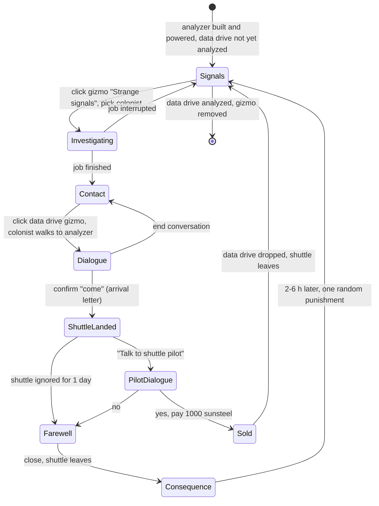
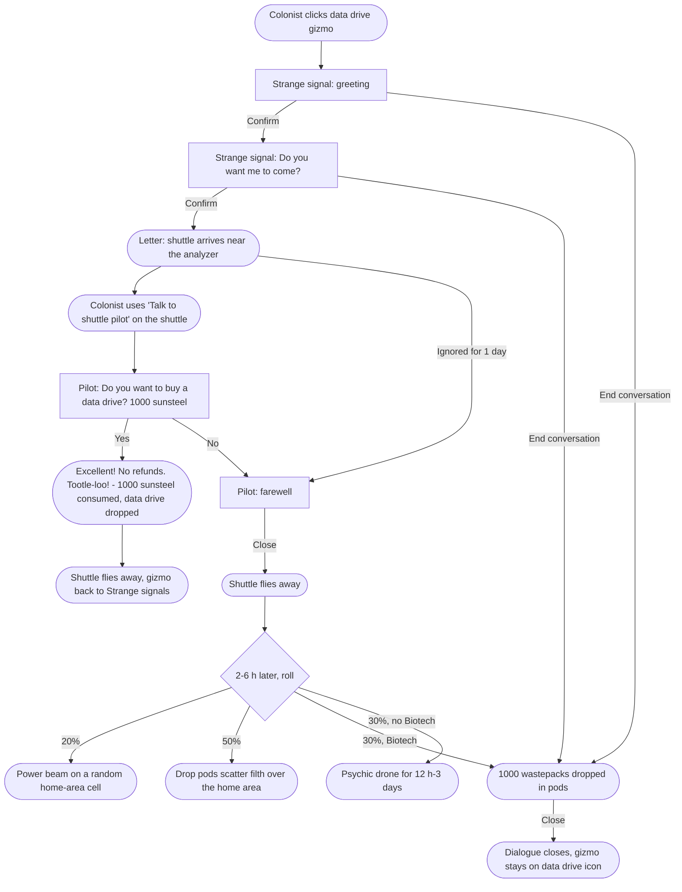
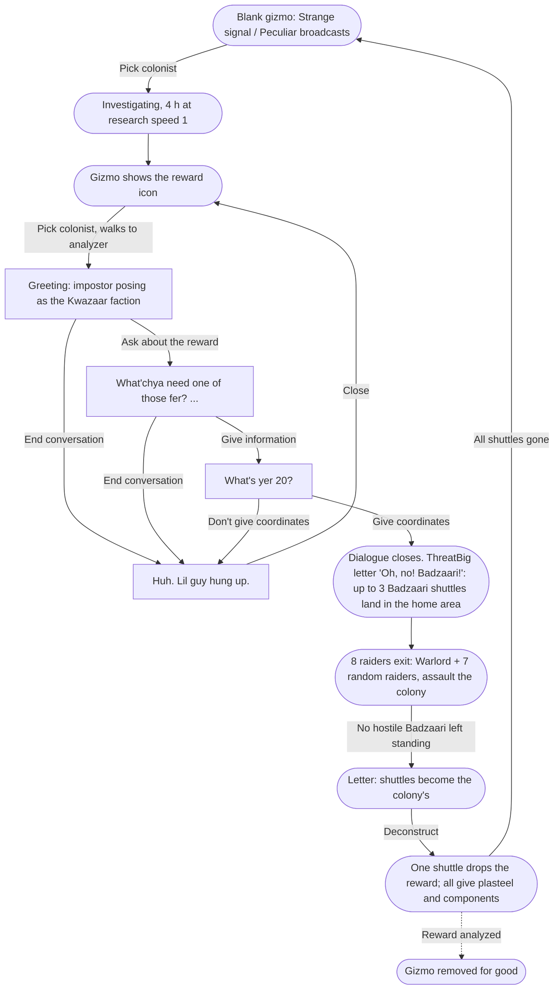
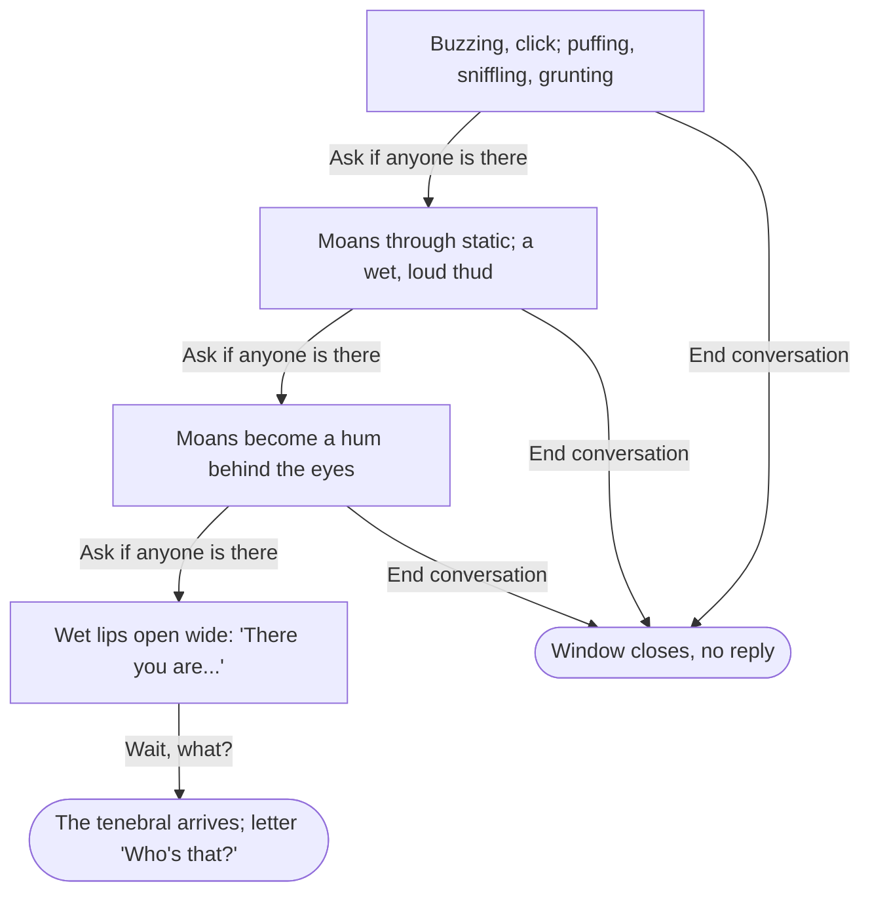

# Artifact Rework Specification

## Purpose
Makes BOR artifacts attainable and analyzable at the research bench of their tier.

- **Analysis:** vanilla analysis takes the item to the closest powered research bench of any kind, which in practice meant the hi-tech research bench. Non-tenebral artifacts are now analyzed at the solar fluid simulation array, and tenebral artifacts at the sigma-class sagittary autoscope. Implemented by `AnalysisBench.cs`, the `modExtensions` in `ThingDefs_Artifacts.xml`, and `pathCost` on the analyzers in `Buildings_Research.xml`.
- **Acquisition (planned):** the solar fluid simulation array picks up strange signals that lead to a Kwazaari shuttle selling the data drive. See *Data drive acquisition*.

## Background
`CompAnalyzable` (unless `canStudyInPlace`) calls `StudyUtility.TryFindResearchBench(pawn, out bench)` from `CanInteract` (to enable the gizmo) and `OrderForceTarget` (to pick the job's bench). Vanilla searches `ThingRequestGroup.ResearchBench` (every `Building_ResearchBench` subclass, so BOR analyzers included) for the closest reachable bench the pawn can reserve and that is powered. It never checks the bench def, and the search does not receive the item. No XML field controls this.

## Requirements

### Requirement: Analysis bench extension
`DefModExtension_AnalysisBench` SHALL hold a `benches` list of research bench `ThingDef`s. An analyzable item carrying it SHALL only be analyzable at one of those benches. Items without it SHALL keep vanilla behaviour.

### Requirement: Bench search patch
While `CompAnalyzable.CanInteract` or `CompAnalyzable.OrderForceTarget` runs, the patch SHALL remember the analyzed item and clear it in a finalizer. A prefix on `StudyUtility.TryFindResearchBench` SHALL, when the remembered item has the extension, replace the vanilla search: the closest reachable `ThingRequestGroup.ResearchBench` thing (interaction cell path end) whose def is in `benches`, that the pawn can reserve, and that is powered (or has no power comp).

#### Scenario: Allowed bench available
- WHEN a colonist is ordered to analyze a data drive and a powered solar fluid simulation array is reachable
- THEN the job goes to that array, even if a hi-tech research bench is closer

#### Scenario: No allowed bench
- WHEN no allowed bench is reachable, reservable and powered
- THEN the Analyze gizmo is disabled with vanilla's "no research bench" reason

### Requirement: Artifact bench assignment
| Artifact | Unlocks | Bench |
|---|---|---|
| `BOR_DataDrive` | `BOR_Research_Analyzer_II` | `BOR_Research_Unlocker_I` (solar fluid simulation array) |
| `BOR_DiluteTenebriteShard` | `BOR_Research_Analyzer_III` | `BOR_Research_Unlocker_II` (sigma-class sagittary autoscope) |
| `BOR_TenebriteMotor` | `BOR_Research_Analyzer_III` | `BOR_Research_Unlocker_II` (sigma-class sagittary autoscope) |

Each artifact's `inspectString` SHALL name its bench. `BOR_CircuitBoard` and `BOR_TenebriteAmplifier` are construction components, not analyzable, and are unaffected.

### Requirement: Analyzer path cost
Every BOR analyzer building (`BOR_Research_Unlocker_I` to `_IV`) SHALL have `pathCost` above 30 (set to 50, matching `HiTechResearchBench`).

The study job places the item on `bench.Position`, has the pawn stand on the bench's interaction cell, and fails the wait toil with `FailOnCannotTouch(item, ClosestTouch)`. `GenPath.ResolveClosestTouchPathMode` turns ClosestTouch into OnCell when the target cell's path cost is 30 or less, and into Touch (adjacent) only above 30. With the default path cost of 0 the pawn would have to stand on the item's tile, so the job ended right after the item was set down.

#### Scenario: Analysis at an analyzer
- WHEN a colonist sets a data drive down on a solar fluid simulation array
- THEN they analyze it from the interaction cell instead of walking away

## Data drive acquisition

Status: implemented with placeholder dialogue text, pending in-game testing. Code in `StrangeSignals.cs`, defs in `Common/Defs/StrangeSignals.xml`, strings in `Languages/English/Keyed/BOR_StrangeSignals.xml`. The comp is on `BOR_Research_Unlocker_I`.

Dev mode adds test gizmos: on the analyzer "Finish investigation", "Consequence now" (rolled), "Laser", "Junk pods", "Wastepacks / drone" and "Clear pending consequence"; on the shuttle "Time out now".

### Flow

### Dialogue

### Requirement: Availability
The signal gizmo SHALL be offered by `BOR_Research_Unlocker_I` while it is spawned, player-owned and powered, and only until a `BOR_DataDrive` has been analyzed (`AnalysisManager` holds a satisfied record for its analysis ID). `AnalysisManager.IsAnalysisComplete` SHALL NOT be used for this: it returns true when no record exists, i.e. before any data drive has ever spawned. After that the gizmo SHALL disappear for good. Until then the event is repeatable: every purchase or refusal returns the comp to **Signals**.

#### Scenario: Data drive analyzed
- WHEN a colonist finishes analyzing a data drive
- THEN no solar fluid simulation array shows the signal gizmo again

### Requirement: Signal gizmo
`BOR_Research_Unlocker_I` SHALL have a comp (`CompStrangeSignals`) that adds the gizmo.

- In the **Signals** state the gizmo SHALL have no icon (blank texture) and the tooltip "Strange signals".
- Clicking it SHALL let the player pick a colonist, who walks to the analyzer's interaction cell and runs the job "Investigating strange signals".
- When the job finishes, the comp SHALL switch to the **Contact** state and the gizmo icon SHALL become the `BOR_DataDrive` texture.
- If the job is interrupted, the state SHALL stay **Signals**.

#### Scenario: Investigation finished
- WHEN a colonist completes "Investigating strange signals"
- THEN the gizmo shows the data drive icon

### Requirement: Investigation job
`BOR_InvestigateSignals` SHALL go to the analyzer's interaction cell, face the analyzer, and wait with a progress bar. The duration SHALL be 4 in-game hours at research speed 1 and scale with the pawn's research speed, like analysis. The job fails if the analyzer is despawned, forbidden or unpowered.

### Requirement: Signal dialogue
In the **Contact** state, clicking the gizmo SHALL let the player pick a colonist, who walks to the analyzer and opens a `Dialog_NodeTree` when they arrive.

- Node 1, greeting from the strange signal: **Confirm** goes to node 2; **End conversation** closes it.
- Node 2, "Do you want me to come?": **Confirm** starts the shuttle arrival; **End conversation** closes it.
- Closing the dialogue at any point SHALL leave the comp in **Contact**, so it can be reopened.

Dialogue text is to be supplied.

### Requirement: Shuttle arrival
On confirm, a shuttle SHALL land as a skyfaller on a reachable, roofless cell near the analyzer (vanilla `Shuttle` def or a BOR-styled copy), and a letter SHALL announce it, targeting the shuttle. The comp SHALL move to **ShuttleLanded** and the gizmo SHALL be disabled while the shuttle is present. The shuttle SHALL offer a "Talk to shuttle pilot" option to colonists (gizmo or float menu).

### Requirement: Pilot dialogue
"Talk to shuttle pilot" SHALL send the colonist to the shuttle and open a `Dialog_NodeTree` with "Do you want to buy a data drive?".

- **Yes:** SHALL be disabled with a reason when the map holds fewer than 1000 `BOR_Sunsteel`. All sunsteel spawned on the map counts, wherever it lies, forbidden or not. Otherwise it consumes 1000 sunsteel, drops one `BOR_DataDrive` next to the shuttle, the shuttle leaves, and the comp returns to **Signals**.
- **No:** SHALL go to the farewell node.

#### Scenario: Purchase
- WHEN the colonist chooses Yes with at least 1000 sunsteel on the map
- THEN 1000 sunsteel is removed, a data drive appears by the shuttle, and the shuttle takes off

### Requirement: Farewell
The farewell node SHALL have a single **Close** option. Closing it SHALL make the shuttle leave and schedule a consequence. The farewell SHALL be reached either by choosing **No**, or by leaving the shuttle untouched for 1 in-game day (the farewell dialogue then opens on its own).

#### Scenario: Shuttle ignored
- WHEN nobody talks to the pilot for 1 in-game day
- THEN the farewell dialogue opens, and closing it sends the shuttle away and schedules a consequence

### Requirement: Consequence
Leaving after a farewell SHALL schedule one consequence for a random tick 5000-15000 ticks (2-6 in-game hours) later, rolled when it fires:

| Chance | Consequence |
|---|---|
| 20% | Vanilla `PowerBeam` on a random cell in the home area |
| 50% | Drop pods land on random home-area cells and each impact spreads 50-70 filth (thickness 3) within radius 6, picked from `Filth_Vomit`, `Filth_AnimalFilth`, `Filth_Trash`, `Filth_Slime`, `Filth_CorpseBile`, and leaves a slag chunk |
| 30% | With Biotech: 1000 `Wastepack` (200 stacks of 5) dropped in pods across the home area |
| 30% | Without Biotech: vanilla `PsychicDrone` game condition on the map for a random 12 h-3 days |

- No warning letter SHALL be sent. When the consequence fires, the camera SHALL jump to where it happens (the impact cell, or the map for the psychic drone).
- If the home area is empty, cells SHALL be picked near colony-owned buildings instead.
- The pending consequence SHALL be saved (map or game component), so it survives save and load.
- After it fires, the comp SHALL return to **Signals**.

### Requirement: Persistence
The comp state (Signals, Investigating, Contact, ShuttleLanded, shuttle timeout) and any pending consequence SHALL be saved with the game.

## Tenebral artifact acquisition

Status: implemented with placeholder dialogue text, pending in-game testing. Code in `SignalRaids.cs` (shared helpers in `StrangeSignals.cs`), defs in `Common/Defs/StrangeSignals.xml`, strings in `BOR_StrangeSignals.xml`. Two `CompProperties_SignalRaid` comps on `BOR_Research_Unlocker_II`.

### Flow

### Requirement: Channels
`BOR_Research_Unlocker_II` SHALL carry two signal channels, each its own blank gizmo with a tooltip:

| Channel | Tooltip | Comp | Faction | Reward |
|---|---|---|---|---|
| `strangeSignal` | Strange signal | `CompProperties_SignalRaid` | `BOR_BadzaarHazaard` | `BOR_TenebriteMotor` |
| `peculiarBroadcasts` | Peculiar broadcasts | `CompProperties_SignalTenebral` | `BOR_Tenebrites` | `BOR_DiluteTenebriteShard`, plus `BOR_TenebriteMotor` without Badzaari |

The Strange signal gizmo SHALL NOT exist when the Badzaari faction is not in the world (e.g. removed at world creation); Peculiar broadcasts then also provides the motor (see *Peculiar broadcasts*). Each channel SHALL be repeatable until its reward has been analyzed, then its gizmo disappears. It SHALL be disabled while the analyzer is unpowered or while that channel's shuttles are still on the map.

### Requirement: Investigation and dialogue
Investigation SHALL work as for the data drive (shared job, 4 in-game hours scaled by research speed). In contact state the gizmo shows the reward's icon. Each channel's text comes from `dialoguePrefix` keys; the greeting names the impersonated faction (`impersonatedFaction`, the world's `BOR_KwazaarBazaar` name, else the def label). The structure SHALL be:

1. Greeting: **End conversation** goes to "hung up"; **Ask about …** goes to 2.
2. Ask reply: **Give information** goes to 3; **End conversation** goes to "hung up".
3. "What's yer 20?": **Give coordinates** closes the dialogue and launches the raid; **Don't give coordinates** goes to "hung up".

The raid letter's title is the channel's `_Ambush` key ("Oh, no! Badzaari!").

"Hung up" has only **Close** and keeps the contact state, so the dialogue can be reopened. Strange signal has final text; Peculiar broadcasts still has placeholders.

### Requirement: Raid
**Yes** SHALL land up to 3 `BOR_RaidShuttle` skyfallers on open, roofless spots in the home area, at least 15 cells apart, and send a ThreatBig letter. The crew SHALL be the `BOR_Badzaari_Warlord` plus 7 random Badzaari raider kinds (sword, shotgun, rifle, sniper, LMG) of faction `BOR_BadzaarHazaard`, split between the shuttles. There is no fallback faction. They exit through the shuttle's door one at a time, starting 90 ticks after landing and then every 35 ticks, with a dust puff. The door is the cell in front of the middle of the south side, or the nearest free cell around the hull if that is blocked. Each shuttle's crew shares one `LordJob_AssaultColony` lord. The raid only counts as beaten after every crew member has exited.

### Requirement: Shuttles and reward
Raid shuttles SHALL have no hit points and SHALL NOT be deconstructible while the raid is on. Once every shuttle has released its crew and no non-downed hostile pawn of the raid faction remains on the map, all shuttles SHALL become player-owned and a letter SHALL say so. Deconstructing gives the normal refund of their cost (100 plasteel, 4 advanced components). Exactly one shuttle per raid SHALL drop the channel's reward when deconstructed. Shuttles stay until deconstructed; the channel frees up when all are gone.

### Requirement: Peculiar broadcasts
The Peculiar broadcasts gizmo SHALL always exist (it does not depend on either faction). It is done once the shard has been analyzed, and, when the Badzaari are missing, the motor too. Investigation is as above. The dialogue SHALL be its own chain (`dialoguePrefix` + `_Stage1`.. `_Stage4`):

End conversation closes at once and keeps the contact state. The last stage's only option is `_Final` ("Wait, what?"); choosing it SHALL:

1. If no `BOR_Tenebrites` faction exists, create it and take over a random non-player settlement whose faction has at least 2 (any non-player settlement if none qualify; a new settlement on a random tile if there are none at all). The settlement is renamed with the tenebral namer and a NegativeEvent letter says "Your meddling caused <old name> to be slaughtered by Tenebral Vanquishers." Hanging up never creates the faction.
2. Send one hostile `BOR_Tenebral_Executioner` with the shard in his inventory, so it drops when he dies. The ThreatBig letter's title is the `_Ambush` key, "Who's that?".
   - **Badzaari present:** he lands in a deep-red drop pod (`BOR_TenebralPodIncoming`) somewhere in the home area.
   - **Badzaari missing:** he comes in a deep-red `BOR_TenebralShuttle`, which works like the raid shuttles: locked until he is beaten, then the colony's to deconstruct, and it drops the tenebrite motor.

The gizmo SHALL be disabled ("The tenebral is still here.") while he is alive on the map, or while the tenebral shuttle stands.

### Requirement: Anti-air leaves the guests alone
The signal chains' arrivals (`BOR_SignalShuttleIncoming`, `BOR_TenebralShuttleIncoming`, `BOR_TenebralPodIncoming`) carry `DefModExtension_NoAntiAir`. Anti-air SHALL NOT target them, even when a hostile pawn is inside. The Badzaari raid shuttles stay fair game, subject to the tier rule below.

### Requirement: Anti-air is tier-gated
`DefModExtension_BorTier` gives factions and anti-air turrets a tier: Solar Republic 1, Kwazaar Bazaar and Badzaari 2, Tenebral vanquishers 3, Umbrals 4, and the solar defender turret 1. Anything unmarked (vanilla, CE and VFE Security turrets, other mods' factions) is tier 0, the Ultra level. A skyfaller's tier is the highest tier among the factions of the pawns inside it, at any depth. Anti-air SHALL still target and fire at every hostile skyfaller, but a hit SHALL only count when the skyfaller's tier is at most the turret's tier plus one: Ultra-level anti-air downs up to Solar, Solar up to Kwazaari, Kwazaari up to Tenebral, Tenebral up to Umbral. Any other hit is spent without effect (no damage to the pod or anyone inside); it throws sparks and, at most once a second per pod, a floating "Deflected". A new BOR anti-air turret needs the marker with its tier.

The guest rule hooks targeting: Combat Extended's skyfaller CIWS (`VerbCIWSSkyfaller` and `CompCIWSTarget_Skyfaller` friendliness) and VFE Security's point defense (`CompPointDefense.IsValidTransporter`). The tier rule hooks the hit: CE's `CompCIWSImpactHandler_Skyfaller.OnImpact` (by the round's launcher) and VFE Security's `CompPointDefense.TryIntercept`. The patches live in `Source/Buildings/AntiAir.cs` and switch themselves off when the mod is not loaded.

### Requirement: Dev gizmos
Dev mode SHALL add, per channel: "Finish investigation", "Arrive", and "Forget analysis" once the channel is done. Peculiar broadcasts also gets "Arrive by shuttle" and "Arrive by pod" to test both routes regardless of the Badzaari.

## Construction artifacts

The analyzer components are craftable, very expensive, and need the *next* tier's materials, one bench below the analyzer they build.

| Component | Builds | Bench | Research | Ingredients | Work | Crafting |
|---|---|---|---|---|---|---|
| `BOR_CircuitBoard` (×3 needed) | sigma-class sagittary autoscope | `BOR_Bench_I` (sunsteel shaper) | `BOR_Research_Analyzer_II` | 150 quasar alloy, 3 kwazaari universal parts, 4 advanced components, 10 gold | 30000 | 15 |
| `BOR_TenebriteAmplifier` (×5 needed) | dark mirror | `BOR_Bench_II` (Kwazifab quasar fabricator) | `BOR_Research_Analyzer_III` | 150 tenebrite, 100 quasar alloy, 4 kwazaari universal parts, 4 advanced components, 20 gold | 45000 | 17 |

Recipes in `Recipe_SunsteelBench.xml` and `Recipe_QuasarBench.xml`.

### Requirement: Artifact research unlocks the next tier
The research an artifact is analyzed for SHALL unlock, on the bench below the next analyzer, both the inefficient next-tier material recipes and the component recipe:

| Research (artifacts) | Bench | Unlocks |
|---|---|---|
| `BOR_Research_Analyzer_II` (data drive) | sunsteel shaper | `BOR_Make_QuasarAlloy_Bad`, `BOR_Make_ComponentII_Bad`, `BOR_Make_CircuitBoard` |
| `BOR_Research_Analyzer_III` (shard + motor) | Kwazifab | `BOR_Make_Tenebrite_Bad`, `BOR_Make_TenebriteAmplifier` |

`BOR_Make_Tenebrite_Bad` was previously gated by `BOR_Research_NSynth_II`.

## Open questions
- **Dialogue text:** the greeting, "Do you want me to come?", the pilot's offer and the farewell. You'll supply them.
- **Filth pods:** how many pods, and how much filth each? Proposed 15-25 pods with 6-10 filth each.
- **Psychic drone level:** proposed high, gender random as vanilla.
- **Consequence timing:** the 2-6 h delay is applied to all three consequences, not only the laser.
- **Pod colour:** the incoming pod is tinted deep red; the opened pod left on the ground keeps the vanilla colour.
- **Tenebral dialogue text:** Peculiar broadcasts lines, plus the raid arrival and "shuttles abandoned" letters.

## Notes
- To allow more benches for an artifact (e.g. a higher-tier analyzer), add entries to its `benches` list.
- The vanilla "no research bench" reason does not name the required bench; the inspect string covers that.
- Patches are applied by the assembly-wide `PatchAll` in `SettingsWindowPatch.cs`.
